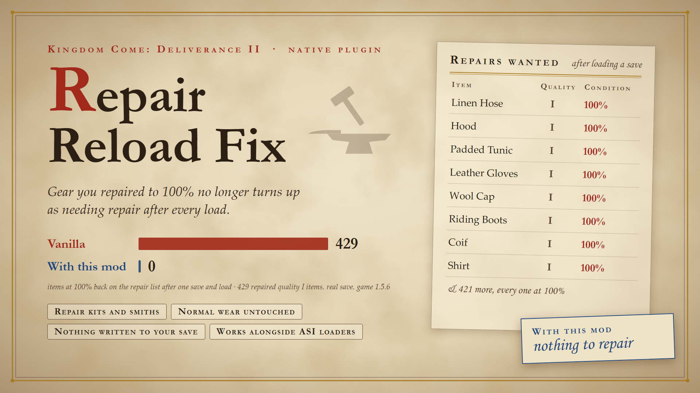
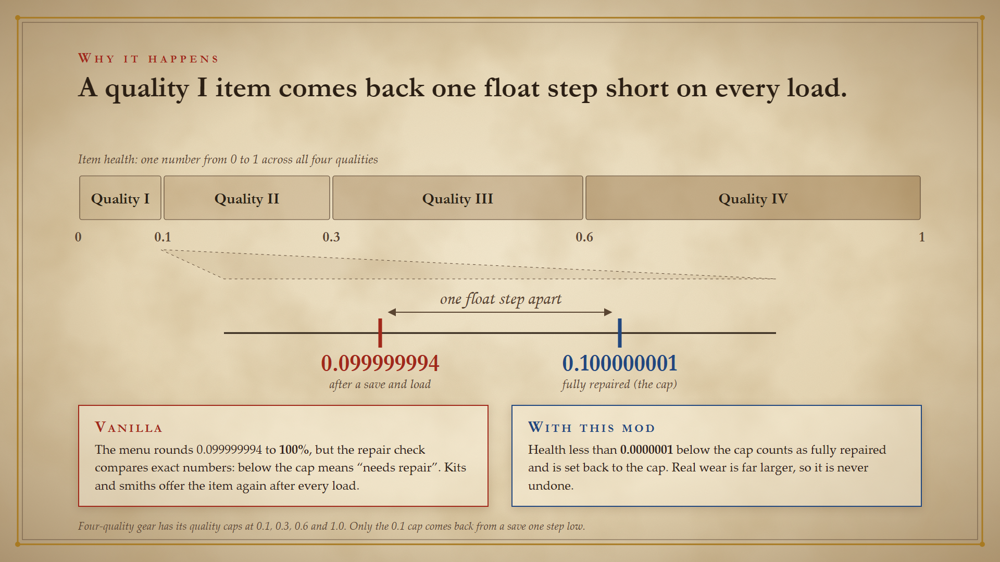

# Repair Reload Fix

A native plugin for Kingdom Come: Deliverance II. In vanilla, gear you repaired to 100 % comes back as "needs
repair" after every load: repair kits and the repair lists of smiths, armourers and tailors offer it again, even
though the inventory shows 100 %. With this plugin it stays repaired.

No pak and nothing is written to your save. Normal wear, repair amounts, prices and quality are not changed. You can
add or remove it at any time.

## Who notices it

Only quality I items of four-quality gear are affected, and only once they are at full condition. You see it most
when you carry a lot of items (carry weight mods) and your gear does not wear down (durability mods): then the
repair list fills up with 100 % items after every load. With normal wear these entries blend in with items that
really are damaged.

## Cause

Item health runs from 0 to 1 across all qualities. For an item class with four qualities, the quality caps are
0.1, 0.3, 0.6 and 1.0. A repair refills an item up to the cap of its current quality. For quality I that is the
float 0.100000001.

After a save and a load the same item comes back with 0.099999994, one float step below the cap. The 0.3, 0.6
and 1.0 caps survive a reload unchanged.

The inventory rounds 0.099999994 to 100 %, but the game's checks do not round:

- **Repair kits** check `cap > health`. This is a `C_RepairKit*Combiner` virtual in `WHGame.dll`, shared by all
  kit types.
- **Shops** list an item while its condition is below 1. The condition is health mapped from the quality's range
  to 0..1, and 0.099999994 maps to 0.99999994.

Measured on 1.5.6 with a real save:

- 429 quality I items were repaired from 0.099999994 to 0.100000001.
- After saving and loading, all of them were back at 0.099999994.

## How it is fixed

"Just below the cap" means less than `fTolerance` below it. The default is 0.0000001 on the 0..1 health scale. A
load leaves the value one float step below the cap, which is about 0.0000000075 at 0.1.

1. **Condition from health** (item manager; used by shops, item lists and the condition display): a health just
   below the cap counts as 100 %.
2. **Health from condition** (item manager): a result just below the cap is returned as the cap.
3. **Snap to cap** (`bSnapToCap`): when the game asks for an item's cap or condition, the item's own health is
   set to the cap if it is just below it. Checks that read the raw health then agree.
4. **Repair-kit checks:** both checks shared by all kits (weapon, armor, clothes, shoes, bow, gun) treat an item
   just below the cap as fully repaired:
   - the "can this item be repaired with the kit" check (`cap > health`)
   - the "is this item fully repaired" check (`health >= cap`)

The tolerance is kept this small so that real wear, even a single small step of it, is never taken back.

## Install

1. Copy `rstrtmgr.dll` and `RepairReloadFix.ini` to the folder that contains `WHGame.dll`
   (Steam: `KingdomComeDeliverance2\Bin\Win64MasterMasterSteamPGO\`).
   The release zip already has this folder layout, so you can extract it into the game folder.
2. The plugin writes `RepairReloadFix.log` in the same folder. The last setup line should read
   `repair-kit checks: both patched; function hooks: all installed`.

To uninstall, delete the two files (and the log).

### Why `rstrtmgr.dll`

`WHGame.dll` loads `rstrtmgr.dll` (the Windows Restart Manager) and `dinput8.dll`, and Windows looks for both in
the game folder first. The plugin passes every Restart Manager function on to the system `rstrtmgr.dll`.

`dinput8.dll` is the name ASI loaders use. Mods such as Third Person View Toggle and KCD2 Lua Development Tools
ship one, and two files with the same name cannot sit in one folder. No known KCD2 mod uses `rstrtmgr.dll`.

If another mod ever needs `rstrtmgr.dll`, rename this file to `dinput8.dll`. It works under either name, and as
`dinput8.dll` it passes `DirectInput8Create` on to the system `dinput8.dll`. If both copies are loaded, only the
first one patches the game.

## Settings

`RepairReloadFix.ini`, read when the game starts:

| Key | Default | Meaning |
|---|---|---|
| `bEnabled` | 1 | 0 patches nothing. |
| `bSnapToCap` | 1 | 0 leaves the stored health as it is. The checks still treat it as fully repaired. |
| `fTolerance` | 0.0000001 | The largest shortfall below the cap still treated as fully repaired (0 - 0.01). Raising it would also take back real wear smaller than it. |
| `bLogCallers` | 0 | 1 logs each distinct caller of the hooked functions (diagnostics). |

The first 20 corrections of each kind are always logged.

## Compatibility

- Tested on the Steam version 1.5.6 (`WHGame.dll`). All places are found by byte pattern. If a pattern is not
  found exactly once, that place is not patched and the log says so.
- `WHGameArm.dll` (the variant the launcher uses on some systems) is not supported. The log says so, and
  nothing is patched.
- Works alongside mods that install a `dinput8.dll` (ASI loaders), because it uses a different file name.
- Pak mods, durability mods and carry weight mods are not affected.

## Building

Run `build.bat`. It needs Visual Studio 2022 or Build Tools 2022 with the x64 C++ tools, which include `ml64`.
The output is `build\rstrtmgr.dll`.

- `src\RepairReloadFix.cpp`: the patches and hooks, and the pass-through for `dinput8.dll`.
- `src\RmStubs.asm`: the pass-through for the Restart Manager functions.
- `src\proxy.def`: the exports of both DLLs.

## Support

All my mods are free. If this one made your game better and you'd like to say thanks, you can
[buy me a coffee](https://buymeacoffee.com/quoteproxy). There are no paid perks or early access.

## License

MIT. See [LICENSE](LICENSE).
